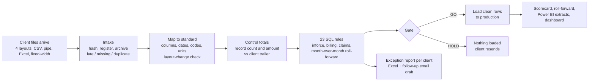

# Retro Client Data Intake & Reconciliation

A working model of the monthly client-data process at a life retrocession reinsurer: take in
policy-level files from ceding companies, map every client's own layout to one standard format,
check the data, reconcile it to the client's control totals and to last month, hold back what is
wrong, load what is right, and tell each client exactly what to fix.

> **All data is synthetic and every client, treaty and person is fictional.** The generator plants
> 156 known problems across 30 types, and the tests prove the pipeline catches every one of them
> with no false alarms on clean data.

## The Streamlit app

`streamlit run app/streamlit_app.py` opens a 14-page app that walks through the whole job, top to bottom:

| Section | Page | What you can do |
| --- | --- | --- |
| Overview | Control room | Click any file on the board of every client, month and file type; read an AI briefing per client |
| | Role coverage | Every responsibility in the job posting, linked to the page that does it |
| Monthly run | 1. Intake and file tracking | Arrival timeline vs due dates, file register, duplicates by hash; **upload a client file** and watch it get hashed, matched, parsed and checked against its controls |
| | 2. Mapping and onboarding | See each client's raw layout next to the standard format; **onboard a new client with the AI mapping assistant**, edit its suggestions, test-run them through the real rules and get the config entry |
| | 3. Validation rules | Rule catalogue with SQL; **rule workbench** to draft and run a new rule on staged data (read-only) |
| | 4. Reconciliation | Control totals, inforce roll-forward waterfall, every premium against the treaty rate, claims against ceded amount |
| | 5. Exceptions and root cause | Pareto, client heatmap, recurring issues, a policy's full history, AI triage, case tracker |
| | 6. Client follow-up | Drafted email per client and month, four tones (or Claude), edit, download with the Excel report |
| | 7. Gate and load | **What-if sliders** for the hold limit; see which files would change decision; data lineage |
| Reporting | Quality scorecards | Score heatmap and trend, what drives each score, loaded portfolio, Power BI extracts |
| GenAI assistants | Ask the data | Plain-English questions become SQL you can see and edit, run under guardrails |
| | Ask the runbook | Retrieval-augmented answers from the runbook and rule catalogue, with citations |
| Controls | Testing and UAT | Planted vs caught by check, run the test suite, **change-impact** comparison, UAT sign-off |
| | Data governance | Data dictionary with classification, audit trail from a production record to its file hash, controls |

The sidebar regenerates the whole quarter with any seed and three defect profiles (baseline, heavy, clean), and every page
updates. Each run is scored against its answer key.

### GenAI, with guardrails

Every AI feature works offline with a transparent method, and switches to Claude when `ANTHROPIC_API_KEY` is set in
the app's secrets (model set by `RETRO_AI_MODEL`):

| Feature | Offline method | With Claude |
| --- | --- | --- |
| Mapping assistant | Profiles each column (name similarity, date formats, code sets, magnitudes) and scores it against each standard field | Reviews the proposed mapping |
| Ask the data | Keyword intent parser for clients, months, files, severities and topics | Writes the SQL from the schema |
| Ask the runbook | BM25 retrieval, answer built from the matching sentences with citations | Writes the answer from the retrieved passages only |
| Exception triage | Concentration analysis plus a knowledge base of likely causes | Root-cause write-up |
| Follow-up tone | Template rewrites | Rewrite that must keep every fact |

Guardrails: AI output is always shown to a person first; generated SQL runs on a read-only connection with external
access off, one SELECT only and a 500-row limit (`safesql.py`, tested); only table and column names are sent to the model,
never client records; AI never decides what loads.

### Deploy on Streamlit Community Cloud

Push the repo to GitHub, create an app at share.streamlit.io pointing at `app/streamlit_app.py`, and it installs from
`requirements.txt`. The first page load builds the synthetic quarter (about 6 seconds). To turn on the Claude features,
add `ANTHROPIC_API_KEY` under the app's Secrets.

## What one run does



| Step | What happens | Code |
| --- | --- | --- |
| Intake | Every arriving file gets a SHA-256 hash and a row in the file register. Resent copies are rejected by hash, late files are flagged against the due date (10th of the next month), and expected files that never came are listed. Files are archived by client and month. | `intake.py`, `scripts/Invoke-FileIntake.ps1` |
| Mapping | One YAML entry per client maps its columns, date format, codes (sex 1/2 vs M/F, status IF/LA/DC...) and units (face in thousands, premium in cents) to the standard format. Unknown codes and unreadable dates are kept raw, never guessed. A renamed or missing column stops the file. | `mapping.py`, `config/clients.yaml` |
| Controls | Record count and amount total are compared with the client's trailer row, control file or control sheet. | `pipeline.py` |
| Rules | 23 set-based SQL rules in a catalogue: completeness, validity, uniqueness, consistency, cross-file reconciliation (billing and claims vs inforce, premium vs treaty rate) and roll-forward against last month. | `config/rules.yaml`, `validate.py` |
| Gate | A file is **held** if a file-level control fails, or if more than 2% of its rows fail a critical rule. Otherwise it **goes**, and only the failing rows are held back. | `validate.py` |
| Load | Clean rows from GO files go to production tables, tagged with the load batch. Tests prove rows loaded + rows held back = rows received. | `validate.py` |
| Outputs | Excel exception report and follow-up email draft per client and month, a client scorecard, the inforce roll-forward, recurring issues, Power BI CSV extracts and the dashboard data. | `report.py` |

## Results from the synthetic run (Oct 15, 2026 control run, Jul–Sep 2026 data)

| Measure | Value |
| --- | --- |
| Files registered | 36 (+1 expected file never received) |
| Decisions | 31 GO, 4 HOLD, 1 rejected duplicate |
| Rows received | 66,740 |
| Rows loaded to production | 54,523 |
| Rows held back for correction | 119 |
| Checks | 31 (23 SQL rules + 8 file-level checks) |
| Planted problems caught | 156 of 156, 0 false alarms (also tested on other seeds, a heavy profile with 432 problems, and a clean profile) |

The four held files, and why:

| File | Reason |
| --- | --- |
| `HRL_billing_202608.txt` | Control file says 4,036 records, file has 4,033 |
| `Kestrel_inforce_202609.xlsx` | Face amount total is 12,345.67 off the control sheet |
| `HRL_inforce_202609.txt` | Client renamed `TobaccoCd` to `TobaccoUse` without notice |
| `AMR_inforce_202609.dat` | 2.4% of rows have the wrong currency (limit 2%) |

## The rules

| Area | Rules |
| --- | --- |
| File | Count vs control, total vs control, layout changed, file missing, sent twice, late, extra column, no control |
| Inforce | Required field missing, duplicate policy/life, unreadable date, DOB after issue, issue age vs DOB, face ≤ 0, above jumbo limit, retro share outside 0–100%, unknown code, issue age outside treaty, wrong currency |
| Billing | Policy not in inforce, negative premium not a reversal, premium on terminated policy, duplicate line, premium more than 25% off the treaty rate |
| Claims | Policy never reported, event before issue date, claim above ceded amount, claim on a policy still active |
| Roll-forward | Active last month but missing with no termination, face changed by over 50%, new this month but issued long ago |

Adding a rule is one entry in `config/rules.yaml`: a SQL query that returns the failing rows. Adding a
client is one entry in `config/clients.yaml`.

## Run it

```bash
pip install -e ".[dev]"
python -m retro_intake.pipeline --generate   # build the synthetic inbox, then run everything
python -m pytest -q                          # 50 tests
streamlit run app/streamlit_app.py           # the app
```

PowerShell intake on Windows or PowerShell 7:

```powershell
./scripts/Invoke-FileIntake.ps1 -Inbox ./data/inbox -Archive ./data/archive_ps -Register ./output/file_register_ps.csv -WhatIf
Invoke-Pester ./tests/Intake.Tests.ps1 -Output Detailed
```

GitHub Actions runs the Python tests and the Pester tests on every push.

## Repository

```
config/clients.yaml        client layouts, codes, units, treaty limits and rate basis
config/rules.yaml          the rule catalogue (SQL)
src/retro_intake/          generate, intake, mapping, validate, report, pipeline,
                           ai (GenAI helpers), safesql (guardrails), onboarding, evaluate
app/                       Streamlit app: streamlit_app.py, core.py, views/ (14 pages)
docs/runbook.md            sample team runbook (searched by Ask the runbook)
scripts/                   Invoke-FileIntake.ps1 (PowerShell intake)
sql/tsql/                  SQL Server version: tables, dq.usp_ValidateInforce, dq.usp_GateAndPromote
tests/                     pytest (pipeline, mapping, AI, guardrails, scenarios, every app page) and Pester
output/                    created by a run: warehouse.duckdb, exception_reports/, client_followups/, powerbi/
```

## Notes and limits

- The engine is DuckDB so the whole thing runs anywhere with `pip install`. `sql/tsql/` holds the
  SQL Server version of the tables and the main procedures (validation, gate and load, with
  transactions and TRY/CATCH). Those scripts are not run by CI.
- The treaty rate basis is a simple synthetic yearly renewable term formula, used only to test the
  "premium vs treaty rate" check.
- Real client data would need encryption at rest, access controls and a retention schedule; the
  archive folder here only shows the structure.
